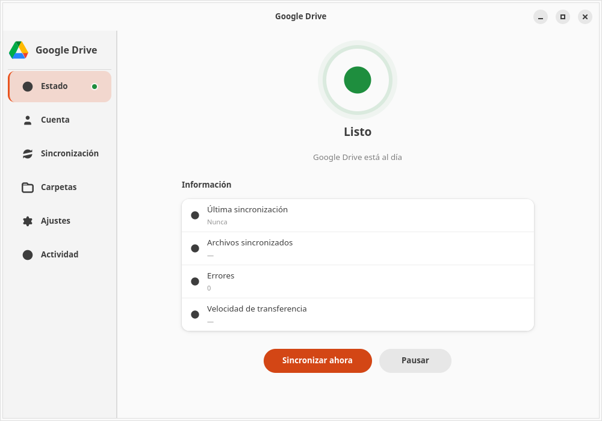
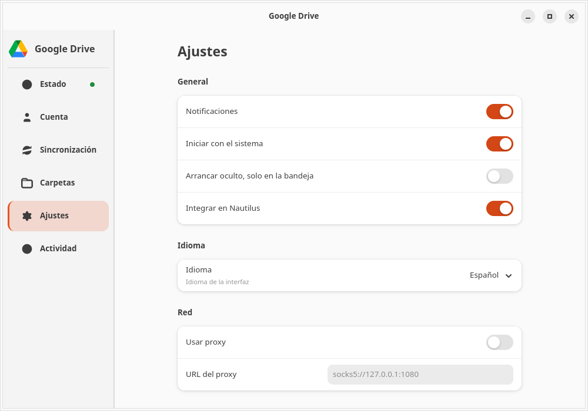

# GDrive — Desktop Client for Ubuntu

A native Google Drive desktop client for Ubuntu and other GNOME-based Linux distributions.
Built with GTK4/libadwaita for the main window, a GTK3/AppIndicator3 system-tray daemon, and rclone for synchronization.

[](https://github.com/diegonaranjo/GDrive-ubuntu/actions/workflows/ci.yml)
[](LICENSE)

---

## Why this exists

Ubuntu has no first-party Google Drive client, and GNOME Online Accounts
dropped Drive file support in 3.58. The usual workaround is `rclone` on the
command line, which is capable but not something a desktop user will configure
by hand, or `rclone bisync`, which is genuinely bidirectional but has a state
directory and a set of flags that are easy to get wrong in ways that silently
lose data.

GDrive wraps that engine in a normal desktop app: a tray icon, a window with
status, account, folders and logs, and a sync engine that applies the flags
correctly by default.

## What you can do with it

This is MIT-licensed on purpose. Use it, fork it, sell a supported build of it,
ship it inside a distro, or rewrite it in another language. There is no
contribution agreement, no CLA, and no requirement to ask first.

The one thing we ask, because it is the reason the project exists: if you fix a
bug or add a feature that makes it better for everyone, a pull request is
welcome, and issues describing what does not work for you are just as valuable.
If you take it in a different direction, that is equally fine — a fork that
serves a community we did not think of is still a win.

Read `CHANGELOG.md` and `AGENTS.md` before contributing: the architecture notes
record *why* the engine is shaped the way it is, including the failure modes
that a naive `rclone bisync` wrapper hits.

## What it does not do

- It is not affiliated with, or sponsored by, Google. You authenticate with your
  own rclone remote, and GDrive never sees or stores your Google credentials.
- Native Google Docs, Sheets and Slides cannot be edited offline and round-tripped
  back in place. `bisync` downloads them in an Office format; treat those as
  exports rather than working copies.
- It does not implement Drive's "on-demand / online-only" storage. The engine is
  `rclone bisync`; a `rclone mount` backend would be a welcome contribution.

---

## Screenshots

| Status | Settings |
|--------|----------|
|  |  |

Captured against a synthetic demo tree, not a live account: the app was run with
`GDRIVE_REMOTE` and `HOME` pointed at a temporary sandbox, so the numbers,
folder names and account details in these images are not real.


- **GTK4/libadwaita UI** with a sidebar and six pages
- **Google Drive visual identity** — official palette, animated status badges with halo, gradient progress bars
- **System-tray icon** with iconified menu and live status
- **Synchronization** via rclone bisync (manual or scheduled)
- **Selective sync** per remote folder
- **Full configuration** — bandwidth limits, transfer threads, exclusion patterns, proxy, cache
- **Toasts, confirmation dialogs, keyboard shortcuts** (Ctrl+S, Ctrl+R, Ctrl+,, F5)
- **Desktop notifications** when a sync finishes
- **Logging system** with rotation and ZIP export
- **Nautilus extension** with a contextual menu
- **Fully portable** — no hardcoded paths, runs from any user folder

## Requirements

- Ubuntu 22.04 LTS+ (or any distro shipping GNOME and GTK 4.10+)
- Python 3.10+
- rclone
- Internet connection

### Dependencies

```bash
sudo apt install \
    gtk4 libadwaita-1 \
    python3-gi python3-gi-cairo \
    gir1.2-gtk-4.0 gir1.2-adw-1 gir1.2-gio-2.0 \
    gir1.2-gdk-4.0 gir1.2-glib-2.0 \
    gir1.2-ayatanaappindicator3-0.1 \
    python3-nautilus gir1.2-nautilus-4.1 \
    rclone
```

---

## Quick start

```bash
# 1. Clone
git clone https://github.com/diegonaranjo/GDrive-ubuntu.git ~/GDrive
cd ~/GDrive

# 2. Install icons, .desktop launcher, tray service, and the Nautilus extension
./setup.sh

# 3. Configure rclone (first time only)
rclone config
#   → n (new remote)
#   → name: gdrive
#   → type:  drive
#   → follow the OAuth wizard in the browser

# 4. Launch the app
bash ~/GDrive/launch.sh
```

Optional — start the tray icon at login:

```bash
systemctl --user enable --now gdrive-tray.service
```

> `setup.sh` runs **without sudo** and only touches your `~/.local`, `~/.config`, and the user-scoped systemd service. No root privileges required.

---

## Configuration

Everything is stored in `~/.config/gdrive/settings.json`. The app populates defaults automatically.

| Option                  | Default         | Description                                           |
| ----------------------- | --------------- | ----------------------------------------------------- |
| `sync_dir`              | `~/GoogleDrive` | Local sync folder                                     |
| `sync_interval`         | `manual`        | Frequency (`manual`, `5min`, `15min`, `30min`, `1hr`) |
| `bandwidth_limit`       | `""`            | rclone limit (`1M`, `500k`, …)                        |
| `notifications_enabled` | `true`          | Desktop notifications                                 |
| `logging_enabled`       | `true`          | Persist logs                                          |

The sync folder and the rclone remote can be changed from the UI (the **Sync** page). The default remote is `gdrive:` (override it with the `GDRIVE_REMOTE` environment variable).

---

## Usage

### Main window (six pages)

| Page         | Purpose                                              |
| ------------ | ---------------------------------------------------- |
| **Status**   | Current state, sync now, pause (with animated badge) |
| **Account**  | Email, storage usage, account management             |
| **Sync**     | Folder, mode, interval, bandwidth, threads           |
| **Folders**  | Pick which remote folders to sync                    |
| **Settings** | General, network, cache, encryption, logs, About     |
| **Activity** | Activity log with search                             |

### Keyboard shortcuts

| Shortcut | Action          |
| -------- | --------------- |
| `Ctrl+S` | Sync now        |
| `Ctrl+R` | Pause / Resume  |
| `Ctrl+,` | Go to Settings  |
| `F5`     | Refresh account |
| `Ctrl+Q` | Quit            |

### Tray icon

Click the Google Drive icon in the system tray to open the iconified menu: sync, pause, open local folder, open in browser, manage account.

---

## Useful commands

```bash
# Run the app directly
python3 gdrive-app.py

# Restart the tray icon
systemctl --user restart gdrive-tray.service

# Tail the logs
tail -f ~/.config/gdrive/debug.log

# Manual sync from the terminal
rclone bisync gdrive:/ ~/GoogleDrive --resync
```

---

## Troubleshooting

### The tray icon does not appear

```bash
systemctl --user status gdrive-tray.service
systemctl --user restart gdrive-tray.service
```

### The app opens a dialog asking to configure rclone

This means rclone does not have the `gdrive:` remote yet. Run:

```bash
rclone config
```

and create a remote named `gdrive` (type `drive`).

### rclone authentication errors

```bash
rclone config delete gdrive
rclone config
```

### Nautilus does not show the extension

```bash
nautilus -q  # Restart Nautilus
```

### The app does not start

Verify the GTK4 bindings:

```bash
python3 -c "import gi; gi.require_version('Gtk','4.0'); gi.require_version('Adw','1'); print('OK')"
```

---

## Performance & Transfer Speeds

Sustained transfer speeds to Google Drive depend entirely on Google API rate limits and connection overheads rather than this client application.

### Why Google Chrome / Drive Web Uploader feels faster
If you upload files through Google Chrome or the Google Drive website, you might notice higher transfer speeds compared to this app (or any `rclone`-based utility). This happens due to technical constraints:
- **HTTP/3 (QUIC) & Internal APIs**: Google's official web client uses proprietary multiplexed HTTP/3 APIs optimized specifically for Google's infrastructure.
- **Developer API Quotas**: Third-party tools like `rclone` connect using the public **Google Drive API v3**, which is subject to strict query-per-second (QPS) throttling (typically capped at 10–20 queries per second for the default global client credentials).
- **Metadata Indexing Overhead**: To keep your files safe from collisions and accidental deletions, `rclone bisync` computes hash signatures and compares local vs. remote metadata before syncing. Chrome just pushes the data without checking for bidirectional sync conflicts.

### How to maximize your sync speed
If you want to significantly increase the transfer and listing speeds in this client, you can:

1. **Configure your own Google Client ID & Client Secret (Highly Recommended)**:
   By default, `rclone` uses shared credentials, which share the global API pool with other users. Creating your own client ID gives you a dedicated API bandwidth channel.
   - Go to the [Google Cloud Console](https://console.cloud.google.com/).
   - Create a project, enable the **Google Drive API**, and create an **OAuth Client ID** (Desktop Application).
   - Run `rclone config` in your terminal, edit your `gdrive` remote, and insert your custom Client ID and Secret.
2. **Increase Transfer Threads**:
   By default, the application is configured to use **8 concurrent transfer threads** (configurable in the *Sync* page). For connection speeds above 100 Mbps, this helps saturate the link when syncing many small files (like PDFs or text documents), offsetting the per-file latency.
3. **Be Patient with the Initial Sync (`--resync`)**:
   The first sync ever performed is always the slowest because the entire remote and local file catalogs must be listed, hashed, and indexed. Once the initial database is built, subsequent automatic syncs are nearly instant (taking only seconds) as they only verify the delta changes.

---

## Project structure

```
GDrive/
├── gdrive-app.py            # GTK4 entry point (thin)
├── gdrive-tray.py           # GTK3 tray daemon
├── launch.sh                # Launcher (daemon + app + tray)
├── setup.sh                 # User install (icons, .desktop, systemd, daemon)
├── install.sh               # Legacy sudo-based installer (alternative)
├── build-deb.sh             # Builds the .deb package
├── verify.sh                # Verifies the installation
├── Makefile                 # Commands: build, install, verify, uninstall
├── native/                  # Native core (Rust) — the sync engine + D-Bus daemon
│   └── gdrive-core/         # Rust crate: config, sync (rclone bisync), logging, i18n, daemon
├── gdrive/                  # Main package (modules)
│   ├── config.py            # DEFAULTS, load/save
│   ├── constants.py         # APP_ID, versions, Google palette
│   ├── daemon_client.py     # D-Bus client for the native daemon
│   ├── helpers.py           # rclone, logging, autostart, notifications
│   ├── widgets.py           # SidebarButton, StatusBadge, ConfirmDialog
│   ├── theme.py             # CSS loader
│   ├── window.py            # DriveWindow (sidebar + toasts + shortcuts)
│   └── pages/               # Six pages (status, account, sync, selective, settings, activity)
├── .github/workflows/ci.yml # CI: Rust (fmt + clippy + test) + Python syntax
├── theme/theme.css          # CSS with Google identity (animations, gradients)
├── icons/                   # google-drive.svg + Lucide symbolic theme
├── desktop-files/           # .desktop templates
└── nautilus-extension/      # Python extension for Nautilus
```

---

## Versioning

- **Version**: 1.1.0
- **Compatibility**: Ubuntu 22.04 LTS+
- **License**: see the [LICENSE](LICENSE) file

---

## Architecture

The heavy lifting (sync, config, logging, i18n) now lives in a **native Rust
core** (`native/gdrive-core/`) that runs as a D-Bus daemon (`gdrive-daemon`).
The GTK4 UI and the GTK3 tray talk to it over D-Bus through
`gdrive/daemon_client.py` (no third-party Python deps). `rclone` is still the
transfer engine, orchestrated by the Rust daemon.

See [`native/gdrive-core/README.md`](native/gdrive-core/README.md) for the daemon
API, the D-Bus interfaces and signals.

---

## Development

### Native core (Rust)

```bash
cd native/gdrive-core
cargo fmt --all -- --check    # formatting
cargo clippy --all-targets --all-features --locked -- -D warnings  # lints
cargo test                    # tests
cargo build --release         # generates target/release/gdrive-daemon
```

The crate follows [Apollo's Rust best practices](https://github.com/apollographql/rust-best-practices):
`thiserror` for typed errors, `#![deny(missing_docs)]`, import grouping via
`rustfmt.toml`, and Clippy lints configured in `Cargo.toml`. The toolchain is
pinned to `stable` with `rustfmt` + `clippy` via `native/gdrive-core/rust-toolchain.toml`.

### CI

GitHub Actions (`.github/workflows/ci.yml`) runs on every push and PR:
Rust `fmt` + `clippy -D warnings` + tests + release build, and Python syntax
verification.

### Contributing

See [CONTRIBUTING.md](CONTRIBUTING.md) for the full development setup, coding
conventions, commit-message style and pull-request checklist.

Community standards live in [CODE_OF_CONDUCT.md](CODE_OF_CONDUCT.md), and
security reports follow [SECURITY.md](SECURITY.md) rather than the issue
tracker.

---

## License

MIT, see [LICENSE](LICENSE). Copyright (c) 2026 diegonaranjo. It says what it
means: use it, change it, distribute it, keep the notice.
